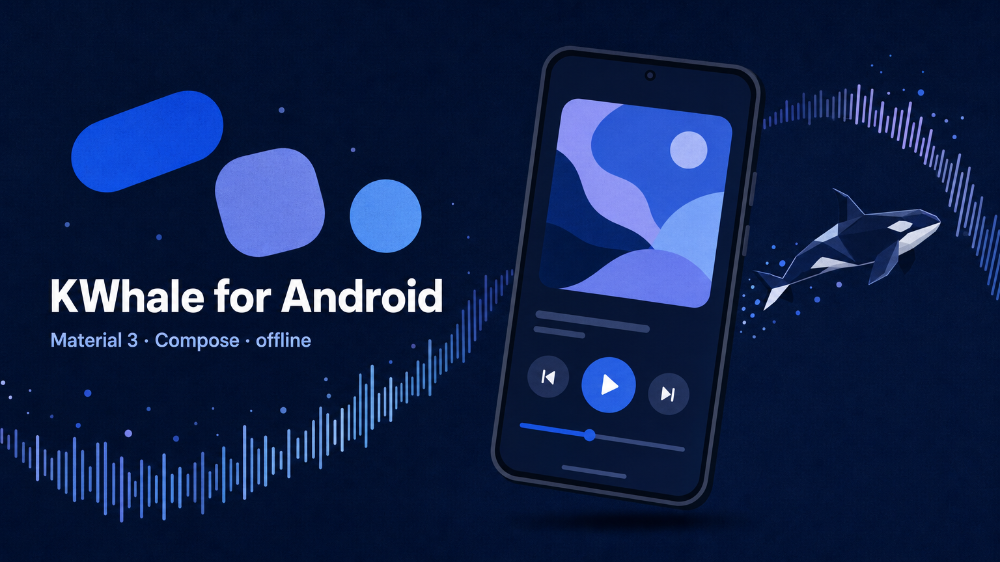
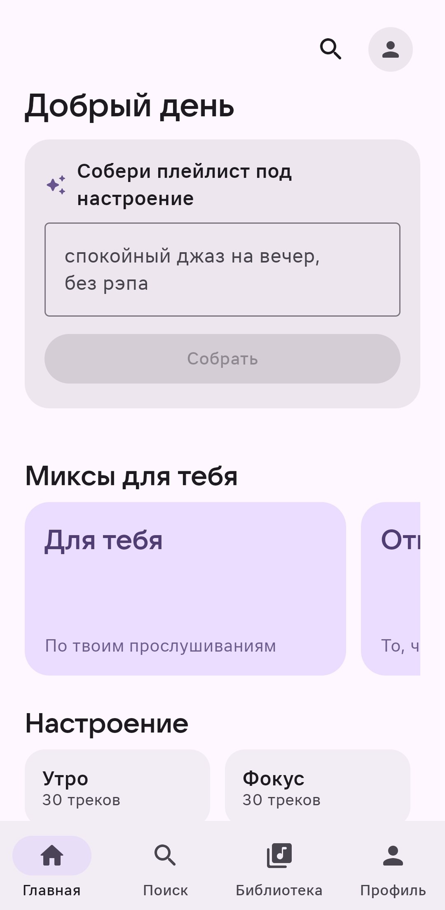
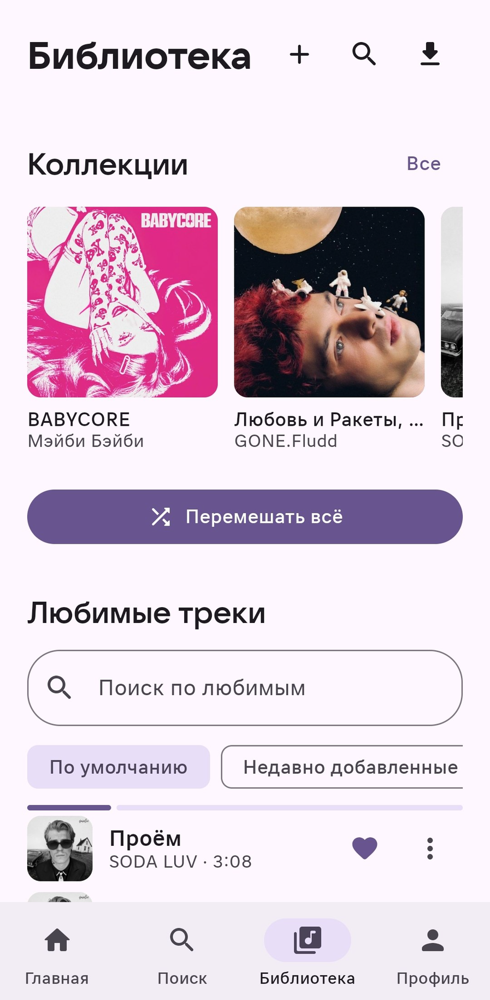

<div align="center">

**English** | [Русский](README.ru.md)

<br/>



# KWhale for Android

**A modern music player for your self-hosted music server.**

[](LICENSE)
[](https://kotlinlang.org/)
[](https://developer.android.com/jetpack/compose)
[](#)
[](https://github.com/KWhale-Music/kwhale-android/actions/workflows/ci.yml)

</div>

A native Android client for [KWhale Server](https://github.com/KWhale-Music/kwhale-server),
written from scratch with **Jetpack Compose + Material 3**. Full theme system
(dark / light / AMOLED / Monet + 129 accents), background playback with Media3,
offline downloads, a home-screen widget and share links that open directly in the app.

## Features

- **Material 3 throughout** — dynamic colors (Monet), pure-black AMOLED, 129 accents,
  dark / light / system themes.
- **Playback** — AndroidX Media3 `MediaSessionService`: background, notification shade,
  lock-screen controls, queue, lyrics.
- **Offline downloads** — built on WorkManager; local playback survives server URL changes
  (files are keyed by remote ID, not URL).
- **Widget** — a Glance mini-player that follows the M3 theme.
- **Sharing** — share tracks/albums/artists, `kwhale://track|album|artist|share` deep links,
  incoming-track bottom sheet.
- **Security** — single-origin API client (`HostPolicyInterceptor` blocks third-party hosts),
  Bearer JWT with refresh-on-401 that survives network blips, tokens in
  `EncryptedSharedPreferences`, cleartext only for loopback / debug builds.

## Screenshots

<div align="center">


</div>

## Quick start

```bash
git clone https://github.com/KWhale-Music/kwhale-android.git
cd kwhale-android
export JAVA_HOME=<jdk-17> ANDROID_HOME=<android-sdk>

# debug build
./gradlew :app:assembleDebug

# release build (R8 + resource shrinking → ~11 MB APK)
./gradlew :app:assembleRelease

# network-layer tests (on low RAM: no daemon, max 2 workers)
./gradlew :core:network:testDebugUnitTest --no-daemon -Dorg.gradle.workers.max=2
```

Prebuilt APKs are attached to [GitHub Releases](https://github.com/KWhale-Music/kwhale-android/releases).

Point the app at your server: **Settings → Server URL**, or set the debug default in
(gitignored) `local.properties`:

```properties
API_BASE_URL=http://<your-lan-host>:19001/v1
```

Release builds default to `https://music.dueattendant149.org/v1` and can switch to any
KWhale instance from the UI.

## Configuration

| What | Where | Notes |
|---|---|---|
| Debug API URL | `API_BASE_URL` in `local.properties` | default `http://10.0.2.2:19001/v1` (emulator) |
| Release API URL | server picker in the app | default `https://music.dueattendant149.org/v1` |
| Release signing | `APPS_*` in `~/.gradle/gradle.properties` | standard release keystore |
| Network security | `res/xml/network_security_config.xml` | release is HTTPS-only; debug builds allow cleartext for LAN dev hosts |

## Architecture

```
app/            — Compose screens, player (Media3), downloads, widget, WorkManager
core:model      — domain models (Track, Album, Artist, Playlist)
core:design     — KwhaleTheme (M3), 129 accents, fonts
core:network    — KwhaleApi, ApiClient (single-origin), TokenStore, DTOs
core:player     — PlaybackState (player state)
api/            — OpenAPI 3.1 KWhale Core v1 contract (+ mock)
```

## Status

Beta — version `0.1.22`.

## License

[AGPL-3.0](LICENSE) — same terms as the server.

The bundled **VK Sans** fonts are excluded from the AGPL and remain the property of
their owners; treat them as replaceable design assets.

## Acknowledgements

The UI is inspired by **VK X**. Thanks for the visual language and the font set.
