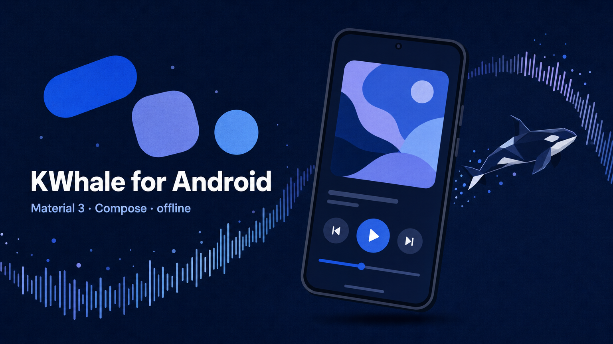
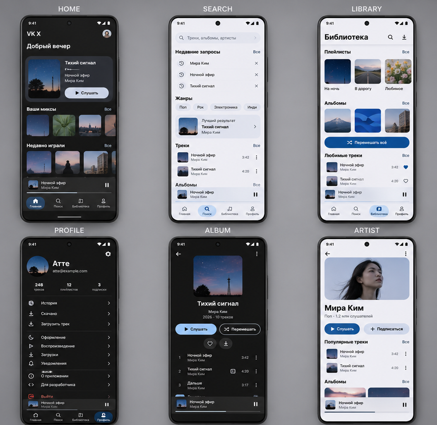
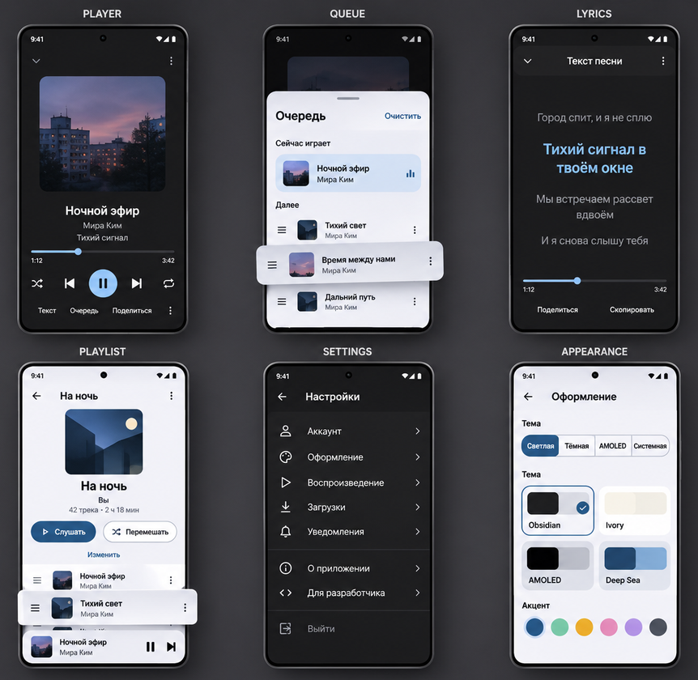

<div align="center">

[English](README.md) | **Русский**

<br/>



# KWhale for Android

**Современный музыкальный плеер для вашего self-hosted музыкального сервера.**

[](LICENSE)
[](https://kotlinlang.org/)
[](https://developer.android.com/jetpack/compose)
[](#)

</div>

Нативный Android-клиент для [KWhale Server](https://github.com/kwhale-music/kwhale-server),
переписанный с нуля на **Jetpack Compose + Material 3**. Полная система тем
(тёмная / светлая / AMOLED / Monet + 129 акцентов), фоновое воспроизведение через Media3,
оффлайн-загрузки, виджет на рабочий стол и шеринг-ссылки, открывающиеся прямо в приложении.

## ✨ Возможности

- **Material 3 во всём** — динамические цвета (Monet), чёрный AMOLED, 129 акцентов,
  тёмная / светлая / системная темы.
- **Воспроизведение** — AndroidX Media3 `MediaSessionService`: фон, шторка уведомлений,
  управление с lock-screen, очередь, тексты песен.
- **Оффлайн-загрузки** — на WorkManager; воспроизведение локальных файлов устойчиво
  к смене URL сервера (файлы привязаны к remote ID, а не к URL).
- **Виджет** — мини-плеер на Glance, следующий M3-теме.
- **Шеринг** — шеринг треков/альбомов/исполнителей, deep links
  `kwhale://track|album|artist|share`, шторка входящего трека.
- **Безопасность** — single-origin API-клиент (`HostPolicyInterceptor` блокирует сторонние
  хосты), Bearer JWT с refresh-on-401, переживающим обрывы сети, токены в
  `EncryptedSharedPreferences`, cleartext только для loopback / debug-сборок.

## 📸 Скриншоты

<div align="center">

<br/>

</div>

## 🚀 Быстрый старт

```bash
git clone https://github.com/kwhale-music/kwhale-android.git
cd kwhale-android
export JAVA_HOME=<jdk-17> ANDROID_HOME=<android-sdk>

# debug-сборка
./gradlew :app:assembleDebug

# release-сборка (R8 + resource shrinking → ~11 МБ APK)
./gradlew :app:assembleRelease

# тесты сетевого слоя (при ограниченной RAM — без демона и max 2 workers)
./gradlew :core:network:testDebugUnitTest --no-daemon -Dorg.gradle.workers.max=2
```

Готовые APK — в [GitHub Releases](https://github.com/kwhale-music/kwhale-android/releases).

Указать свой сервер: **Настройки → URL сервера** или задать дефолт для debug-сборки в
(gitignored) `local.properties`:

```properties
API_BASE_URL=http://<your-lan-host>:19001/v1
```

Release-сборка по умолчанию ходит на `https://music.dueattendant149.org/v1` и переключается
на любой инстанс KWhale прямо в UI.

## ⚙️ Конфигурация

| Что | Где | Примечания |
|---|---|---|
| Debug API URL | `API_BASE_URL` в `local.properties` | дефолт `http://10.0.2.2:19001/v1` (эмулятор) |
| Release API URL | выбор сервера в приложении | дефолт `https://music.dueattendant149.org/v1` |
| Release-подпись | `APPS_*` в `~/.gradle/gradle.properties` | стандартный release-keystore |
| Сетевая безопасность | `res/xml/network_security_config.xml` | в release — только HTTPS; debug-сборки разрешают cleartext для LAN-dev-хостов |

## 🏗 Архитектура

```
app/            — Compose-экраны, плеер (Media3), загрузки, виджет, WorkManager
core:model      — доменные модели (Track, Album, Artist, Playlist)
core:design     — KwhaleTheme (M3), 129 акцентов, шрифты
core:network    — KwhaleApi, ApiClient (single-origin), TokenStore, DTO
core:player     — PlaybackState (состояние плеера)
api/            — OpenAPI 3.1 контракт KWhale Core v1 (+ mock)
```

## 🧭 Review от автора

*Честные заметки автора — раздел в черновике и будет дополняться.*

Чем я реально доволен:

- **Система тем.** 129 акцентов, AMOLED и Monet в одном связном `core:design` —
  это та часть приложения, которая ощущается законченной и личной.
- **Устойчивость сети.** Refresh-on-401 сохраняет сессию при обрывах
  (чистится только на реально невалидном токене), а single-origin политика физически
  не даёт стримам утечь на сторонние хосты.
- **Оффлайн-надёжность.** Привязка загрузок к remote ID вместо URL означает, что смена
  сервера не ломает скачанную библиотеку.

Что честно ещё кривое:

- **Тихие отказы UI.** Часть действий падает без обратной связи (optimistic-состояние
  без отката, no-op у кнопки «Подписаться»). Проход по обработке ошибок — приоритет №1.
- **Пагинация неровная** — часть списков обещает totals, которых нет. Честные totals будут.
- **Lint-долг** — известный набор предупреждений (`@OptIn`, типы foreground-сервисов)
  ещё открыт. Не опасно, просто неаккуратно.

Дальше: честность обработки ошибок, UX прогресса/ретраев загрузок, lint → 0,
и нормальный release-профиль (версионирование, документация по подписи).

## 🗺 Статус

Бета — версия `0.1.22`, автор использует ежедневно на физическом устройстве.

## 📄 Лицензия

[AGPL-3.0](LICENSE) — те же условия, что у сервера.

Сторонние заметки: UI сделан как *пересоздание* — код оригинальный, но набор шрифтов
(VK Sans) и часть визуального языка отсылаются к VK X и остаются собственностью их
владельцев; относитесь к ним как к заменяемым дизайн-ассетам. Стриминг-коннекторы живут
в репозитории сервера и работают с сторонними сервисами на их собственных условиях.
